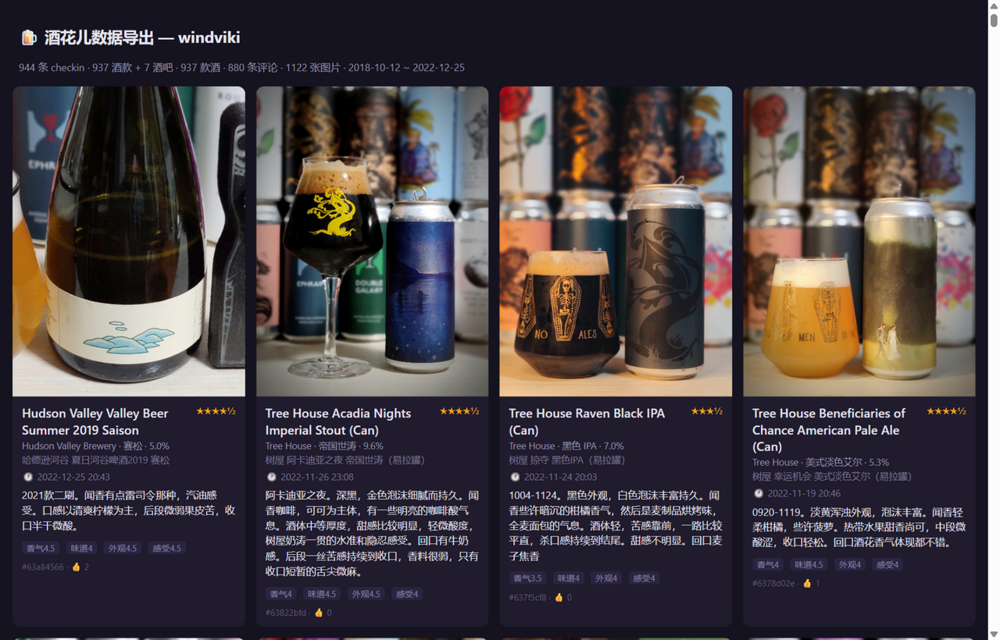

# jiuhuar-checkin-exporter 🍺

> 酒花儿停运数据抢救工具 — rescue **your own** check-in history before the
> servers go dark.

Export **your own** complete check-in history from 酒花儿 (Jiuhuar, the Chinese
craft-beer app): ratings, comments, photos, beer/brewery info (including
English names) — even though the app has stopped operating and login no longer
works.

```
python main.py --nickname YOUR_NICKNAME
```



Produces `output/` with:

| File | Content |
|---|---|
| `index.html` | Dark-theme browsable gallery of all your check-ins (untappd-style) |
| `<nickname>_checkins_full.json` | Normalized full data (ratings, comments, tags, image paths & URLs) |
| `<nickname>_checkins.csv` | Spreadsheet-friendly, opens directly in Excel (UTF-8 BOM) |
| `checkins_beer.json` / `checkins_bar.json` | Raw API data (beer ratings & bar check-ins) |
| `beer_details.json` / `breweries.json` / `bars.json` | Beer & brewery details (Chinese **and English** names, ABV/IBU, style, country, descriptions) and bar info (city, address, opening hours, rating) |
| `images/checkins/` | Your check-in photos at original resolution |
| `images/beers_lg/` | Beer label art at original resolution (`-lg2` PNG, falls back to `-lg` webp) |
| `images/beers/` | Beer label square thumbnails |
| `images/avatars/` · `images/bars/` · `images/profile/` | Comment-author avatars, bar logos, your avatar & profile background |
| `follow_info.json` | Your follower/following **counts** (public) |
| `followers.json` / `following.json` | Full name lists with follow dates — only with `--token` (any logged-in account) |
| `run_log.txt` | What the run did |

> **Privacy**: the `output/` directory contains your personal history (and
> `user_profile.json` may include the phone number bound to your account).
> Keep it local; the `.gitignore` of this repo already excludes it.

## Why this works

The app ended user-side operation (login is dead), but the backend still
serves **public, unauthenticated** data — and every user profile with its full
check-in list is public. So exporting your own history needs no credentials.

Key protocol facts, recovered from the last Android client (v5.8.8) so that
user data can be rescued before the servers go dark:

* API base `https://napi.jiuhuar.com/api/` — TLS certificate expired in 2020,
  verification must be disabled (`verify=False`).
* Requests must carry app-like headers; `content-type: application/json`
  selects JSON responses, and `udid` is used as an AES key.
* Responses are `{"code":0,"crypted":true,"data":"<base64>"}` where `data` is
  **AES-128/ECB/PKCS7** encrypted with the *request's own* `udid` header
  (zero-padded/truncated to 16 bytes) — the client picks its own key.
* Main endpoints:

| Endpoint | Purpose |
|---|---|
| `GET user/id?nickname=` | nickname → user id |
| `GET user/comment/cnt/{id}` | check-in counts (integrity check) |
| `GET comment/v3/user?uid=&lastTime=` | all beer check-ins of a user |
| `GET comment/bar/user?uid=&lastTime=` | all bar check-ins of a user |
| `GET user/v2/he?uid=` | profile |
| `GET beer/v3/{id}` | beer details, `fullName` = `中文|-|English` |
| `GET beer/brewery/{id}` | brewery details incl. English name |
| `GET bar/{id}` | bar details (city, address, opening hours, rating, photos) |
| `GET follow/followInfo?uid=` | follower/following counts (public) |
| `GET follow/user/follower\|following?uid=&lastTimestamp=` | follow lists (needs `x-auth-token`) |

  Lists page by `lastTime` (unix **seconds**): first page `Long.MAX_VALUE`,
  then the last item's `createTime`; page size 10, a short page ends the walk.

* Images (Qiniu CDN):
  * user photos: `https://file1.jiuhuar.com/{uuid}?imageMogr2/auto-orient`
    — the `imageMogr2` query is **mandatory**, plain URLs are blocked by the WAF;
  * beer label thumbnail: `https://file1.jiuhuar.com/bg-{mainPic}`;
  * beer label original resolution: `https://s1.jiuhuar.com/{mainPic}-lg2`.

Rating fields in check-ins (validated against the website):
`r1=香气 aroma, r2=味道 taste, r3=外观 look, r4=感受 feel, rating=总体 overall`.
Beer check-ins carry no geo location by product design; only bar check-ins
reference a bar.

## Install & run

Python 3.10+ required.

```bash
pip install -r requirements.txt
python main.py --nickname YOUR_NICKNAME          # everything, ~15-40 min
python main.py --uid 5xxxxxxxxxxxxxxxxxxxxxx     # if you know your uid
python main.py --nickname X --skip-enrich         # skip beer/brewery details
python main.py --nickname X --skip-images         # skip photo downloads
python main.py --nickname X --token <auth-token>  # adds follower/following name lists
python build_export.py ./output                   # rebuild JSON/CSV/HTML only
```

## Optional: follower/following name lists (experimental)

Follower/following **counts** are public and always exported. The full **name
lists** (`follow/user/follower|following`) require a valid `x-auth-token`
header from any logged-in account.

Login reality (as of 2026):

* the auth backend still **answers** (`POST signin` returns proper error
  codes), but nothing guarantees it still validates old passwords;
* Android login is broken, the website removed user login entirely;
* the SMS verification gateway is dead (codes are accepted by the API but
  never delivered);
* reportedly the **iOS client could still log in** recently — a logged-in
  iOS device is the most realistic source of a working token.

Two optional ways to try:

```bash
# 1) experimental helper — fails gracefully, never blocks the main export
python login.py --username 13500000000 --password 'your-password'   # -> token.txt
python main.py --nickname NICK --token $(cat token.txt)

# 2) have a logged-in iOS device? extract its token and pass it via --token
```

A wrong/expired token only means the lists are skipped:
`main.py` logs it and finishes the rest of the export normally.

## FAQ

* **`nickname not found`** — profiles must be public; also check spelling.
* **Images 403** — always keep the `imageMogr2` query parameter (handled here).
* **Certificate errors** — expected; the client already disables verification.
* **Is my password needed?** No. Login is dead and not needed; only public
  profile data is read.

## Disclaimer

For exporting **your own** data for personal backup/migration. Not affiliated
with jiuhuar. All trademarks belong to their respective owners. If the service
goes down permanently, this tool stops working — that's exactly why it exists.
